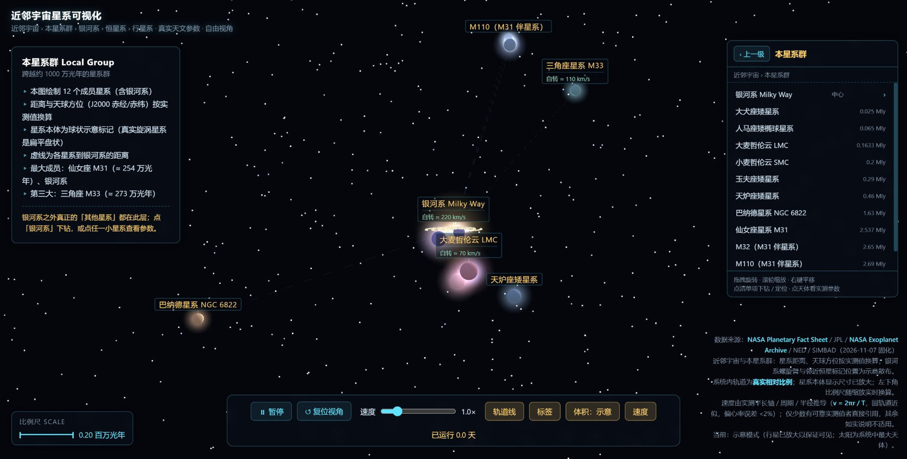
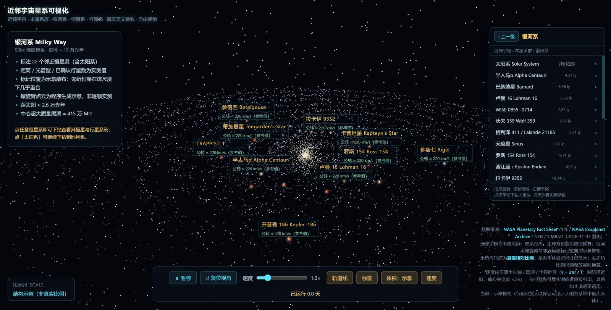
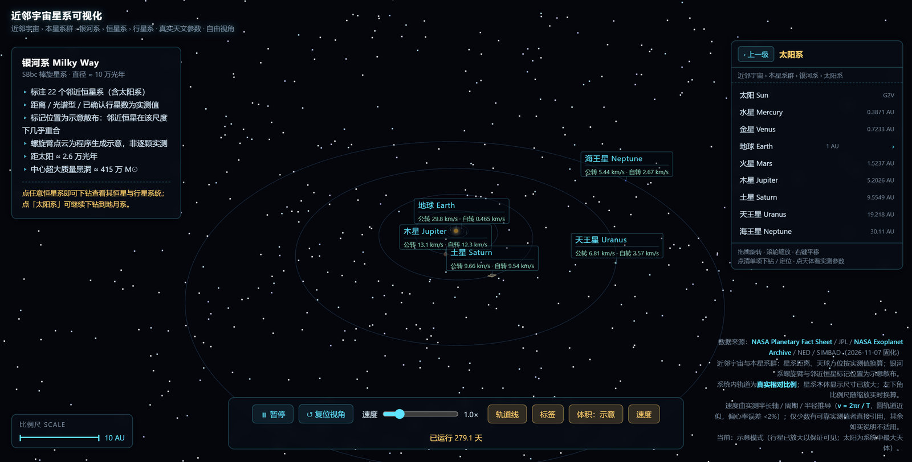

<div align="center">
  

  <h1>Nearby Universe Galaxy Visualization</h1>

  <p><b>English</b> &nbsp;|&nbsp; <a href="./README.zh-CN.md">简体中文</a></p>

  <p><a href="https://galaxy.leoyim.cn"><b>Live demo: galaxy.leoyim.cn</b></a></p>
</div>

---

A browser-based 3D visualization of celestial motion — from galaxies comparable in scale to the Milky Way, down to the Earth–Moon system. Built with Three.js and served as a fully static site: **no build step, no backend, and zero external network requests**. The 3D library and all astronomical data are bundled in this repository.

## Screenshots

### 1. Nearby Universe — galaxies on the same scale as the Milky Way


12 large galaxies (M31, M101, M87, Sombrero, Whirlpool, NGC 6744, and others) positioned by **measured distances** and **J2000 right ascension / declination**. The scale bar reads in million light-years.

### 2. Local Group



12 member systems. The dashed circle marks the Local Group's roughly 10-million-light-year extent; dashed lines show each galaxy's distance to us.

### 3. Milky Way



22 nearby stellar systems with measured distances, spectral types and confirmed planet counts. Spiral-arm star points are a procedural schematic — hundreds of billions of real stars cannot be plotted individually.

### 4. Solar System



Eight planets on real semi-major axes and real orbital inclinations, with orbital and rotation velocities annotated beside each body.

## Features

- **Five-level drill-down**: Nearby Universe → Local Group → Milky Way → Solar System / exoplanet system → Earth–Moon.
- **Hierarchy navigator** (top right): shows the current node, lists every child body, scrolls when the list is long, and provides a "back one level" button.
- **Free camera**: drag to rotate, wheel to zoom, right-drag to pan; smooth camera transitions between levels.
- **Real astronomical data**: distances, orbital periods, radii, inclinations and spectral types from published catalogues.
- **Velocity annotations**: orbital and rotation speeds derived as `v = 2πr / T` from measured parameters. Bodies without a well-defined rotation or orbit are explicitly left unlabelled rather than given an invented number.
- **Dynamic scale bar** (bottom left): real units (million light-years, AU, km) that update as you zoom.
- **Volume mode**: schematic (bodies enlarged so they are visible) vs. true relative radii.
- **Toggles**: orbit lines, labels, velocity rows, time speed (0.1x–5x) and pause.
- **Leader-line labels**: names float above each body with a thin connector, so they never cover the object.
- **Zero external requests** — nothing is loaded from a CDN at runtime.

## Data and accuracy

| Aspect | Approach |
| --- | --- |
| Galaxy distances and sky positions | Published measurements; linear distance mapping and J2000 RA/Dec |
| Planet and moon orbital distances | Real semi-major axes, linear within each system |
| Orbital and rotation periods | Real values, time-accelerated so motion is visible |
| Velocities | Derived as `v = 2πr / T`; only a few well-measured values quoted directly |
| Display sizes of bodies | Deliberately enlarged (true-scale planets would be invisible) |
| Galaxy bodies | Spherical markers — real spiral galaxies are flat disks |
| Milky Way spiral arms | Procedural schematic, not measured star positions |
| Nearby-star marker positions | Schematic scatter (nearby stars overlap at a 100,000 ly scale) |

Sources: **NASA Planetary Fact Sheet**, **JPL Solar System Dynamics**, **NASA Exoplanet Archive**, **NED**, **SIMBAD**. Values frozen on 2026-11-07.

Everything schematic is labelled as such in the app's on-screen data-source note. No values are invented.

## Tech stack

- Three.js r160 (vendored under `vendor/`) with OrbitControls and CSS2DRenderer
- Vanilla ES modules — no bundler, no framework, no packages to install
- Plain CSS for the HUD; `CSS2DRenderer` for leader-line labels
- GitHub Actions → GitHub Pages for deployment

## Run locally

```bash
git clone https://github.com/leoyim/galaxy-visualization.git
cd galaxy-visualization
python3 -m http.server 8080
# open http://127.0.0.1:8080/
```

ES modules require HTTP. Opening `index.html` directly via `file://` will not work.

## Deployment

`.github/workflows/deploy.yml` runs on every push to `main`. It assembles a minimal `_site/` directory containing only the files needed at runtime and publishes it with the official `deploy-pages` action. Pushing to `main` is the only step required to publish.

The `CNAME` file must ship with every deployment, otherwise GitHub removes the custom domain. Custom domain: **https://galaxy.leoyim.cn**.

## Project structure

```
index.html                    root entry, redirects to galaxy.html
galaxy.html                   main application
main_galaxy.js                scene engine, five levels, navigation, HUD
celestial.js                  embedded astronomical data
favicon.svg                   vector logo / favicon
favicon-32.png                PNG favicon fallback
apple-touch-icon.png          iOS home-screen icon
CNAME                         custom domain
vendor/                       Three.js r160 + addons (local, no CDN)
docs/screenshots/             images used in this README
.github/workflows/deploy.yml  Pages deployment
```

## Controls

| Action | Control |
| --- | --- |
| Rotate view | Left drag |
| Zoom | Scroll wheel |
| Pan | Right drag |
| Drill down | Click a named body or a navigator item |
| Back one level | "Back" button in the navigator |
| Time | Pause / speed slider |
| Display | Orbit lines / labels / volume / velocity toggles |

## Repository

https://github.com/leoyim/galaxy-visualization
