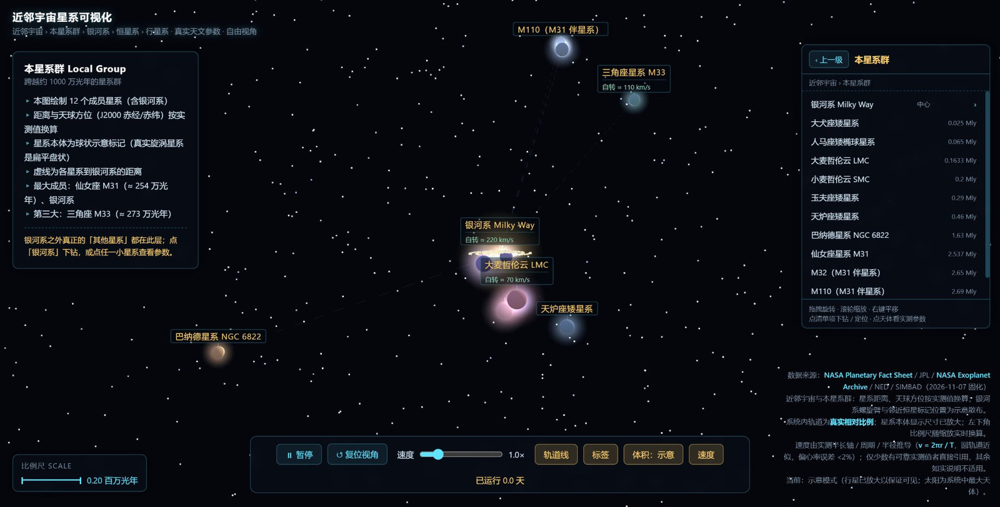
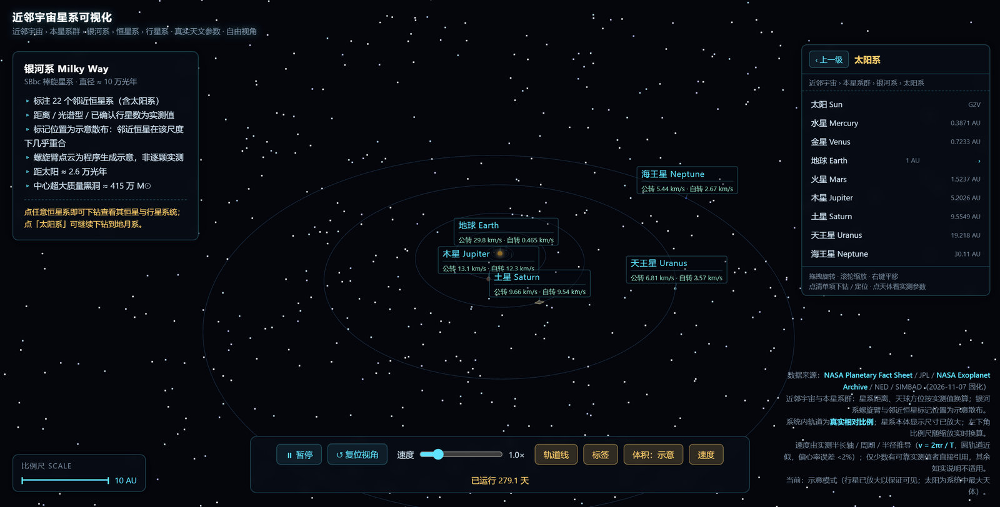

<div align="center">
  

  <h1>近邻宇宙星系可视化</h1>

  <p><b>简体中文</b> &nbsp;|&nbsp; <a href="./README.md">English</a></p>

  <p><a href="https://galaxy.leoyim.cn"><b>在线演示：galaxy.leoyim.cn</b></a></p>
</div>

---

一个直接在浏览器中运行的天体运行 3D 可视化：从与银河系同量级的大星系，一直下钻到地月系。基于 Three.js，纯静态站点，**无需构建、无后端、运行时零外网请求**——3D 库与全部天文数据都打包在仓库内。

## 界面预览

### 1. 近邻宇宙 —— 与银河系平级的大星系


12 个大星系（M31、M101、M87、草帽星系、涡状星系、NGC 6744 等），按**实测距离**与 **J2000 赤经 / 赤纬**换算的真实天球方位绘制。左下角比例尺以百万光年为单位。

### 2. 本星系群



12 个成员星系。虚线圆表示本星系群约 1000 万光年的范围，虚线为各星系到我们的距离。

### 3. 银河系


22 个邻近恒星系，标注实测距离、光谱型与已确认行星数。螺旋臂星点为程序生成的示意分布——银河系数千亿颗恒星无法逐颗实测绘制。

### 4. 太阳系



八大行星按真实轨道半长轴与真实轨道倾角排布，每个天体旁标注公转速度与自转速度。

## 功能特性

- **五级下钻**：近邻宇宙 → 本星系群 → 银河系 → 太阳系 / 系外恒星系 → 地月系。
- **层级导航器**（右上角）：显示当前节点、列出全部子级、清单过长可滚动选择，并提供「返回上一级」按钮。
- **自由视角**：拖拽旋转、滚轮缩放、右键平移；切换层级时相机平滑过渡。
- **真实天文数据**：距离、公转周期、半径、轨道倾角、光谱型均取自公开实测资料。
- **速度标注**：公转与自转速度由实测参数按 `v = 2πr / T` 推导；对不自转或无稳定公转轨道的天体明确不标注，而不是编造数值。
- **动态比例尺**（左下角）：随缩放实时换算，单位分别为百万光年、AU、km。
- **体积模式**：示意（放大以保证可见）/ 真实相对半径，一键切换。
- **显示开关**：轨道线、标签、速度行、时间倍率（0.1×–5×）与暂停。
- **引线标签**：名字浮在天体上方并用细线指回天体中心，不遮挡天体本身。
- **运行时零外网请求**，不从任何 CDN 加载资源。

## 数据来源与真实性

| 项目 | 处理方式 |
| --- | --- |
| 星系距离与天球方位 | 公开实测值，距离线性映射 + J2000 赤经赤纬换算 |
| 行星 / 卫星轨道距离 | 真实半长轴，各系统内部线性比例 |
| 公转 / 自转周期 | 真实值，为可观察而加速演示 |
| 速度 | 由 `v = 2πr / T` 推导；仅少数有可靠实测值者直接引用 |
| 天体显示尺寸 | 刻意放大（真实比例下行星不可见） |
| 星系本体 | 球状示意标记，真实旋涡星系是扁平盘状 |
| 银河系螺旋臂 | 程序生成示意，非逐颗实测位置 |
| 邻近恒星标记位置 | 示意散布（在 10 万光年尺度下邻近恒星几乎重合） |

数据来源：**NASA Planetary Fact Sheet**、**JPL 太阳系动力学常数**、**NASA Exoplanet Archive**、**NED**、**SIMBAD**，数值于 2026-11-07 固化。

所有示意性内容都在页面的数据来源说明中如实标注，不虚构任何数值。

## 技术栈

- Three.js r160（本地 `vendor/`）+ OrbitControls + CSS2DRenderer
- 原生 ES modules —— 无打包器、无框架、无需安装依赖
- HUD 为纯 CSS；`CSS2DRenderer` 负责引线标签
- GitHub Actions → GitHub Pages 自动部署

## 本地运行

```bash
git clone https://github.com/leoyim/galaxy-visualization.git
cd galaxy-visualization
python3 -m http.server 8080
# 浏览器打开 http://127.0.0.1:8080/
```

ES modules 必须经 HTTP 加载，直接双击 `index.html`（`file://`）无法运行。

## 部署方式

`.github/workflows/deploy.yml` 在每次推送 `main` 时触发：先组装最小的 `_site/` 目录（只含运行时必需文件），再用官方 `deploy-pages` 发布。推送到 `main` 即完成上线。

`CNAME` 文件必须随每次部署一起发布，否则 GitHub 会清除自定义域名。自定义域名：**https://galaxy.leoyim.cn**。

## 项目结构

```
index.html                    根路径入口，跳转至 galaxy.html
galaxy.html                   主页面
main_galaxy.js                三维引擎、六个视图、导航与 HUD
celestial.js                  内嵌天文数据
favicon.svg                   矢量 logo / 网站图标
favicon-32.png                PNG 格式 favicon 兼容版
apple-touch-icon.png          iOS 主屏图标
CNAME                         自定义域名
vendor/                       Three.js r160 及插件（本地，无 CDN）
docs/screenshots/             README 配图
.github/workflows/deploy.yml  Pages 部署流程
```

## 操作方式

| 操作 | 方式 |
| --- | --- |
| 旋转视角 | 左键拖拽 |
| 缩放 | 滚轮 |
| 平移 | 右键拖拽 |
| 下钻 | 点击具名天体或导航器清单项 |
| 返回上一级 | 导航器中的「‹ 上一级」按钮 |
| 时间控制 | 暂停 / 速度滑块 |
| 显示控制 | 轨道线 / 标签 / 体积 / 速度 开关 |

## 仓库地址

https://github.com/leoyim/galaxy-visualization
